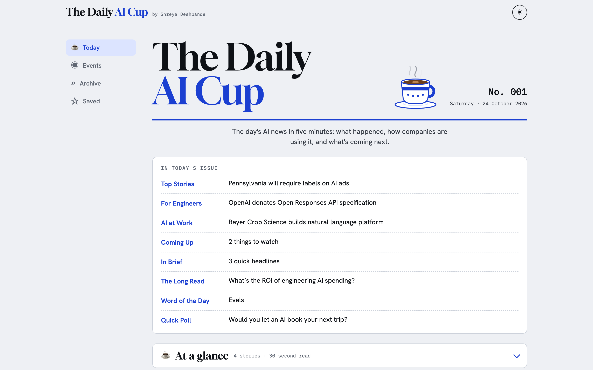

# The AI Brew ☕

[](https://github.com/shreyad1/ai-brew/actions/workflows/tests.yml)

**A 3-minute AI briefing, written every weekday morning by an AI agent, with every fact checked against its source.**

**[theaibrew.pages.dev](https://theaibrew.pages.dev)** · Built by [Shreya Deshpande](https://www.linkedin.com/in/shreya-deshpande-data-business-analyst/)



## What it does

Every weekday at 7 AM Central, with no human in the loop until review:

1. **Gathers** fresh stories from 19 RSS feeds: TechCrunch, The Verge, Ars Technica, MIT Technology Review, The New Stack, company blogs, and AI newsletters on Substack.
2. **Cleans** them: drops sponsored posts, filters non-AI stories, and merges the same news reported by several outlets.
3. **Writes** the issue with Gemini: picks the stories and writes short, plain-English summaries.
4. **Checks** every line against its source. Any number, name, or quote that isn't in the original article is sent back for one rewrite, then dropped.
5. **Publishes** the issue to the web app and commits it, with a log that traces every sentence back to its source.

## The web app

- **Today**: the latest issue. The lead story can be read "like I'm 10", "like a PM", or "like an engineer".
- **Events**: upcoming AI meetups and hackathons in any US state or in New Delhi, Mumbai, and Bengaluru, from Luma's public calendars.
- **Archive**: search every story ever published.
- **Saved**: star stories to read later.
- An **Engineers** mode that adds new developer tools and a concept to know; light and dark themes.

## How it works

```
 RSS feeds ─┐
 Luma (iCal)┤                 ┌─────────────┐
            ├─► MCP server ──►│ digest agent│──► checks.py ──► issue JSON ──► web app (Cloudflare Pages)
            │   (6 tools)     │  (Gemini)   │    numbers,                     email (Buttondown, soon)
            │                 └─────────────┘    names, quotes
 GitHub Actions: runs it every weekday, commits the issue, redeploys the app
```

**The guardrails are the core of the project.** The model only ever sees story IDs, titles, and summaries, never links. It returns JSON that refers to stories by ID, and the code, not the model, attaches every link, source name, and date. `checks.py` then verifies that each number, capitalized name, and quoted phrase in the model's text appears in that story's source.

## The MCP server

`server.py` is a [Model Context Protocol](https://modelcontextprotocol.io) server, so Claude Desktop or any MCP client can use the same tools as the agent:

| Tool | What it returns |
| --- | --- |
| `get_ai_news` | Recent AI stories from major tech outlets |
| `get_company_ai_updates` | How real companies are using AI (optionally for one company) |
| `get_upcoming` | Launches, betas, and events still to come, with a date only if the source states one |
| `get_dev_updates` | New AI tools and techniques for engineers |
| `get_long_reads` | Essays from respected AI newsletters |
| `get_ai_events` | AI meetups and hackathons near a US state or Indian city |

Every tool clamps its inputs, times out after 10 seconds per feed, skips feeds that fail and reports which ones, and never crashes the server.

**More detail:** decisions, trade-offs, failure modes, and what changes at scale are in [docs/DESIGN.md](docs/DESIGN.md).

## Tech stack

Python 3.10 · [uv](https://docs.astral.sh/uv/) · MCP Python SDK · Gemini API · httpx · feedparser · Jinja2 · vanilla JavaScript · GitHub Actions · Cloudflare Pages

## Run it yourself

```bash
uv sync
echo "GEMINI_API_KEY=your-key" > .env    # free key from aistudio.google.com

uv run mcp dev server.py                 # try the tools in MCP Inspector
uv run digest.py --dry-run               # write today's issue into issues/
uv run build_site.py                     # build the web app into site/
uv run pytest                            # 50 tests, no network needed
uv run evals.py                          # fact-check the newest issue with the LLM judge
```

Use the tools in Claude Desktop with `uv run mcp install server.py --name "AI Brew" --with feedparser --with httpx --with pyyaml`.

## Project layout

| File | Job |
| --- | --- |
| `server.py` | MCP server: the 6 tools, each a thin wrapper |
| `feeds.py` | Reading `sources.yaml` and fetching feeds |
| `filters.py` | Text rules: cleaning, sponsored and AI detection, dates, dedupe |
| `evals.py` | LLM-judge faithfulness scores, plus judge calibration |
| `digest.py` | The agent: gather, write with Gemini, check, render |
| `checks.py` | Guardrails for numbers, names, and quotes |
| `llm.py` | The one place that talks to the LLM, with fallback models |
| `events.py` | AI events from Luma city calendars |
| `build_site.py`, `templates/`, `site_static/` | The web app |
| `tests/` | pytest suite: guardrails, filters, dedupe, feeds, tools, events, agent steps (HTTP mocked) |
| `sources.yaml` | Every feed, by section |
| `learning_path.yaml`, `resources.yaml`, `polls.yaml` | Human-reviewed content the agent may copy but never invent |
